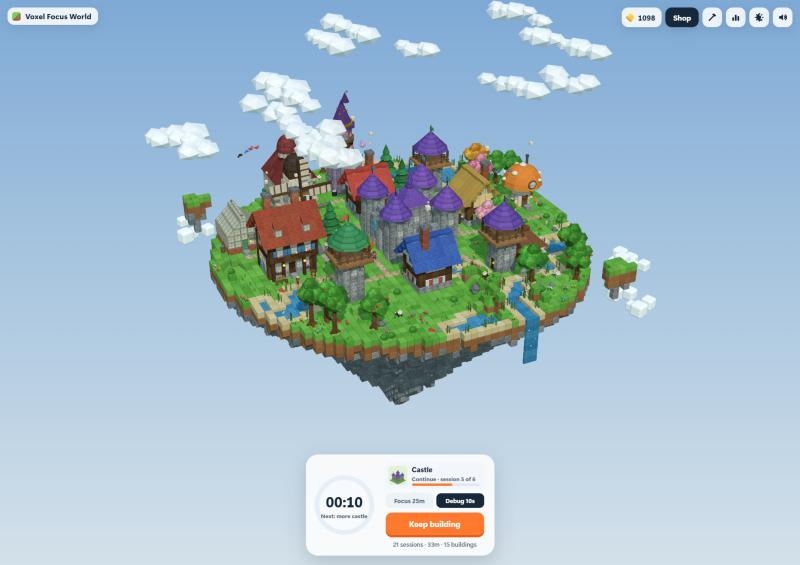

<p align="center"></p>

# Voxel Focus World

A focus timer that builds a cozy voxel village while you work.

**Try it:** https://zachary-malcolm.github.io/voxel-focus-world/. It installs as an app (Chrome/Edge: the install icon in the address bar, or *Install* in the sun/moon menu; iPhone: Share → Add to Home Screen) and works offline after the first visit.



## How it works

- **Focus to build.** Pick a blueprint and start a session. The building rises block by block as the minutes pass, right where it will stand in your village. Give up and only that session's blocks crumble.
- **Coins and blueprints.** Every focused minute earns a coin. Coins buy blueprints, from a wishing well to a cathedral that takes eight sessions. Decor (fences, lamps, benches, flower beds) is bought and placed straight away.
- **A forever world.** Each new building's spot is picked for you by the village layout you've chosen (village green, high street, hamlets…), so there's nothing to decide. Roads are routed from each door to the town square, with bridges where they cross water.
- **It comes alive.** The island grows with your total focus time, and makes room as the village grows. New land reveals hills, lakes and a river with a waterfall and a water wheel. Villagers walk to work and go home at night, and there are sheep, cats, dogs, ducks and birds. Time of day follows your clock, the weather drifts through sun, rain, fog and snow, and soft generative music plays.
- **Builder tools.** You can move, rotate, store or remove buildings, repaint any block's colour and material, and re-arrange the whole village with one-tap layouts (with undo).

Everything is drawn from code: no image or audio assets apart from the app icon. Your village is saved in the browser (localStorage) and never leaves your device.

## Tech

Vite, Three.js (instanced meshes with procedural canvas textures) and Tone.js (synthesised music, ambience and sound effects). No framework and no backend. Offline support is a small service worker generated at build time by a Vite plugin (`vite.config.js` + `src/sw-template.js`), which precaches every built file.

```bash
npm install
npm run dev      # dev server
npm run build    # static site in dist/
npm run preview  # serve the build (the service worker is only registered in builds)
```

The icon is generated by `tools/make_icon.py`. Pushing to `main` deploys to GitHub Pages (`.github/workflows/deploy.yml`).
